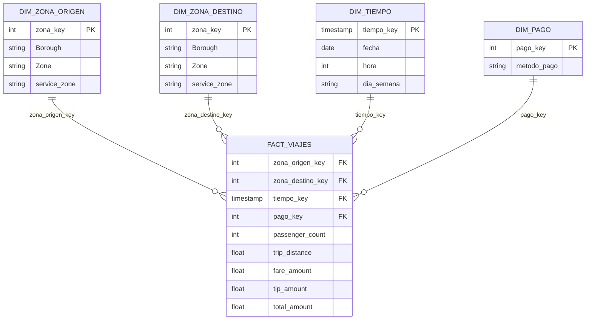
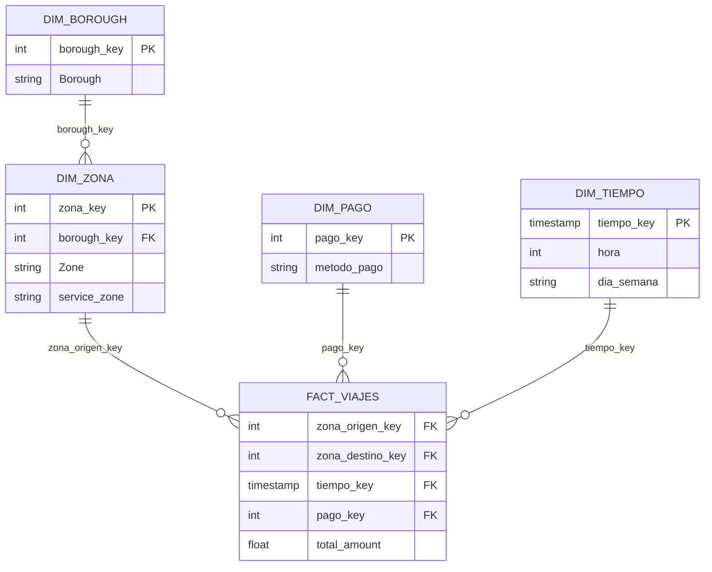

# Sesión 5: SQL II y Data Warehousing

| Campo | Valor |
|---|---|
| Semana | 3 de 5 |
| Duración | 150 minutos |
| Notebook | `notebooks/S05.deepnote` |
| Datasets | NYC TLC Yellow Taxi enero 2024 y `taxi_zone_lookup.csv` (ver `docs/DATASETS.md`) |
| Cuentas | Deepnote (la misma de las sesiones anteriores) |
| Prerrequisitos | Sesión 4 (SQL I: `SELECT`, `WHERE`, `JOIN`, `GROUP BY`, `HAVING`). Haber guardado `datos/viajes_2024_01.parquet` y `datos/zonas.csv` en la sesión 1. |

## Objetivos

- Al terminar, el alumno puede escribir consultas con subconsultas, CTEs (`WITH`) y `CASE WHEN`.
- Al terminar, el alumno puede usar window functions (`ROW_NUMBER`, `RANK`, `SUM OVER`) para rankear y acumular sin perder filas.
- Al terminar, el alumno puede explicar la diferencia entre OLTP y OLAP, y entre normalizar y desnormalizar.
- Al terminar, el alumno puede describir un modelo dimensional (hechos, dimensiones, granularidad, star y snowflake), el lakehouse y la arquitectura medallion, y diagramar el star schema del dataset de taxis.

## Antes de la sesión

- Abre el proyecto del curso en Deepnote y ejecuta "Run all" en `S05.deepnote`. Confirma que `viajes` y `zonas` cargan desde `datos/` sin descargar de nuevo.
- Revisa que los bloques SQL tengan la integración `deepnote-dataframe-sql` y que todos corran.
- Prepara el diagrama del star schema (el de esta guía) en una diapositiva o en la pizarra. Si quieres verlo dibujado, pega el código Mermaid en `mermaid.live`.
- Dibuja en la pizarra tres cuadros para OLTP, almacén de datos y consumo, y tres cajas bronze, silver y gold. Los vas a llenar con los alumnos.
- Prepara el quiz de repaso de SQL I (5 preguntas de esta guía) en una diapositiva o en un Google Form, para los primeros 10 minutos.
- Avisa por correo que la sesión tiene mucha teoría, y que es normal anotar. Pide que lleguen con SQL I fresco: si no hicieron la tarea de la sesión 4, que la revisen antes.
- Lleva el plan B de datos (parquet en carpeta compartida) por si `datos/` no existe en la copia de algún alumno.

## Conceptos y definiciones

### SQL avanzado (5.1 a 5.4)

- **Subconsulta (5.1)**: una consulta `SELECT` escrita dentro de otra, entre paréntesis. Puede ir en `WHERE` (para comparar contra un valor calculado), en `FROM` (como si fuera una tabla temporal) o en `SELECT`. *Ejemplo:* los viajes con `total_amount` mayor al promedio, donde el promedio sale de otra consulta. *Error común:* anidar cuatro subconsultas y no poder leerlas después, para eso existen las CTEs.
- **Subconsulta en `FROM`**: la subconsulta se usa como tabla y necesita un alias. *Ejemplo:* calcular viajes por zona y luego promediar esos conteos. *Error común:* olvidar el alias.
- **Subconsulta con `IN`**: devuelve una lista de valores contra la que se compara. *Ejemplo:* los viajes cuyo `PULocationID` está en las zonas de Manhattan. *Error común:* usar `=` cuando la subconsulta devuelve varias filas.
- **CTE (5.2)**: Common Table Expression, un resultado con nombre que defines con `WITH nombre AS (...)` antes de la consulta principal. Se lee de arriba hacia abajo, como una receta. *Analogía:* preparar ingredientes por separado antes de cocinar el platillo. *Error común:* creer que la CTE se guarda en la base de datos, solo existe durante esa consulta.
- **Varias CTEs encadenadas**: se separan con coma y cada una puede usar las anteriores. Un solo `WITH`, no uno por CTE. *Error común:* repetir la palabra `WITH` o dejar una coma sobrante antes del `SELECT` final.
- **`CASE WHEN` (5.3)**: la forma de poner condiciones "si pasa esto, entonces aquello" dentro de una consulta, para crear categorías. Termina con `END`. *Ejemplo:* clasificar viajes en corto, medio o largo según la distancia. *Error común:* olvidar `ELSE`, las filas que no cumplen ninguna condición quedan en `NULL`.
- **Window function (5.4)**: una función que calcula sobre un grupo de filas relacionadas, pero sin juntarlas en una sola fila como hace `GROUP BY`. Cada fila conserva su detalle y recibe un valor extra. *Analogía:* en una lista de clase, ponerle a cada alumno su lugar dentro del grupo sin quitar a nadie de la lista. *Error común:* creer que reemplaza a `GROUP BY`, hacen cosas distintas.
- **`OVER`**: la cláusula que convierte una función en window function y define la "ventana". Dentro llevan `PARTITION BY` y `ORDER BY`.
- **`PARTITION BY`**: divide las filas en grupos independientes para la ventana. *Ejemplo:* un ranking que reinicia en cada `Borough`. *Error común:* confundirlo con `GROUP BY`, `PARTITION BY` no colapsa filas.
- **`ROW_NUMBER`**: numera las filas 1, 2, 3, sin repetir nunca el número, aunque haya empates. *Error común:* usarlo cuando se quiere que los empates compartan lugar.
- **`RANK`**: numera por orden, y los empates comparten número y dejan huecos después (1, 2, 2, 4). *Error común:* esperar que no haya huecos.
- **`SUM OVER` (suma acumulada)**: una suma que se va acumulando fila a fila según el orden de la ventana. *Ejemplo:* ingreso acumulado día a día. *Error común:* olvidar el `ORDER BY` dentro de `OVER`, entonces suma todo el grupo en cada fila.
- **`QUALIFY`**: un filtro especial de DuckDB que se aplica después de calcular las window functions. Es un atajo, en otras bases de datos hay que usar una CTE. *Error común:* intentar poner una window function en `WHERE`, no se puede.

### Data warehousing (5.5 a 5.12)

- **OLTP (5.5)**: Online Transaction Processing, bases de datos que atienden la operación diaria con muchas escrituras pequeñas y rápidas. *Ejemplo:* el sistema que registra cada viaje de taxi cuando termina. *Error común:* hacer reportes pesados directamente sobre la base operativa y volverla lenta.
- **OLAP (5.5)**: Online Analytical Processing, sistemas hechos para leer y agregar muchos datos y responder preguntas. *Ejemplo:* "¿cuánto se ganó por zona cada hora del mes?". *Error común:* creer que son dos productos distintos, son dos usos, y a veces un mismo motor hace ambos.
- **Data warehouse (almacén de datos)**: una base de datos organizada para análisis, que junta datos de varias fuentes con un modelo pensado para consultarse rápido. *Analogía:* la bodega central de una cadena de tiendas, donde todo está ordenado para surtir.
- **Normalización (5.6)**: separar los datos en tablas pequeñas para no repetir información. *Ejemplo:* guardar el nombre de la zona una sola vez en `zonas` y en `viajes` solo su `LocationID`. *Error común:* sobre-normalizar un almacén de datos, se llenan las consultas de joins.
- **Desnormalización (5.6)**: juntar tablas y repetir datos a propósito para que las consultas sean más simples y rápidas. *Ejemplo:* una tabla de viajes que ya trae `Borough` y `Zone` escritos en cada fila. *Error común:* creer que repetir datos siempre es malo, en análisis es una decisión de diseño.
- **Llave primaria y llave foránea**: la primaria identifica una fila de forma única (`LocationID` en `zonas`), la foránea es la columna de otra tabla que apunta a ella (`PULocationID` en `viajes`). *Error común:* pensar que la llave foránea debe ser única.
- **Tabla de hechos (5.7)**: la tabla central que guarda los eventos que se miden, con números (medidas) y llaves hacia las dimensiones. *Ejemplo:* `fact_viajes`, una fila por viaje. *Error común:* meter ahí descripciones largas, eso va en las dimensiones.
- **Medida**: el número que se suma, promedia o cuenta en una tabla de hechos. *Ejemplo:* `total_amount`, `trip_distance`, `tip_amount`.
- **Granularidad o grano (5.7)**: lo que representa exactamente una fila de la tabla de hechos. Se decide primero, antes que todo lo demás. *Ejemplo:* "una fila por viaje". *Error común:* mezclar granos en la misma tabla (viajes y totales por día juntos), los números dejan de cuadrar.
- **Tabla de dimensión (5.8)**: una tabla de descripción que da contexto a los hechos: quién, dónde, cuándo, cómo. *Ejemplo:* `dim_zona`, `dim_tiempo`, `dim_pago`. *Error común:* confundirla con un hecho, la dimensión describe, el hecho mide.
- **Dimensión de rol**: la misma dimensión usada en dos papeles dentro de un hecho. *Ejemplo:* `dim_zona` sirve como zona de origen y como zona de destino, se une dos veces con alias distintos.
- **Llave sustituta (surrogate key)**: un identificador inventado por nosotros que reemplaza a la llave del sistema de origen. *Error común:* en este curso usamos `LocationID` como llave, para no complicar, pero en un almacén real se suele crear una propia.
- **Star schema o esquema estrella (5.9)**: un modelo con una tabla de hechos al centro y dimensiones directas alrededor, como una estrella. Las dimensiones están desnormalizadas. *Error común:* creer que el hecho depende de las demás en cadena, solo se conecta con cada dimensión.
- **Snowflake schema o copo de nieve (5.9)**: como la estrella, pero con las dimensiones normalizadas en sub-tablas. *Ejemplo:* `dim_zona` apunta a `dim_borough`. Ahorra repetición, pero agrega joins. *Error común:* elegirlo por defecto, para empezar casi siempre conviene la estrella.
- **Data lake**: almacenamiento barato de archivos en su forma original (CSV, JSON, Parquet), sin un modelo impuesto. *Error común:* creer que un lago es un almacén, un lago sin orden se vuelve un "pantano de datos".
- **Lakehouse (5.10)**: una arquitectura que junta lo bueno del lago (archivos baratos y abiertos) con lo bueno del almacén (tablas, transacciones, consultas rápidas). En la sesión 8 lo vemos en Databricks con Delta Lake. *Error común:* pensar que es un producto de una sola marca.
- **Arquitectura medallion (5.11)**: organizar los datos en tres capas de calidad creciente. **Bronze** guarda el dato crudo tal como llegó, **silver** lo limpia y le da forma, **gold** lo agrega para el consumo. *Ejemplo en el curso:* bronze es el parquet original, silver quita viajes con distancia cero, gold es el ingreso por día. *Error común:* limpiar en bronze, se pierde el dato original y no se puede auditar.
- **ETL (5.12)**: Extract, Transform, Load. Se extrae de la fuente, se transforma en un paso intermedio y se carga ya limpio al destino. *Error común:* creer que ETL y ELT son lo mismo con otro orden de letras, cambia dónde se hace el trabajo pesado.
- **ELT (5.12)**: Extract, Load, Transform. Se carga el dato crudo al destino y se transforma ahí, usando el poder del almacén o del motor SQL. *Ejemplo:* cargar el parquet tal cual (bronze) y hacer las capas silver y gold con SQL. *Error común:* creer que ELT elimina la transformación, solo cambia el lugar.

## Guion minuto a minuto

| Tiempo | Dur. | Bloque |
|---|---|---|
| 0 a 10 | 10 | Quiz de repaso de SQL I |
| 10 a 40 | 30 | Subconsultas, CTEs con `WITH` y `CASE WHEN` |
| 40 a 60 | 20 | Window functions: `ROW_NUMBER`, `RANK`, `SUM OVER` |
| 60 a 70 | 10 | Descanso |
| 70 a 90 | 20 | OLTP vs OLAP, normalización vs desnormalización |
| 90 a 115 | 25 | Modelado dimensional: hechos, dimensiones, granularidad, star vs snowflake |
| 115 a 130 | 15 | Lakehouse y medallion, ETL vs ELT |
| 130 a 145 | 15 | Práctica: diagramar el star schema y crearlo con CTEs |
| 145 a 150 | 5 | Cierre y tarea |

### 0 a 10: Quiz de repaso de SQL I

**Qué decir**
- "Antes de avanzar, cinco preguntas de la sesión pasada. No cuenta para nada, es para saber dónde estamos."
- Pasa las 5 preguntas del quiz de repaso (sección "Quiz" más abajo), una por una, y deja que contesten a mano alzada o en el formulario.
- Si alguna falla mucho (por ejemplo `WHERE` contra `HAVING`), tómate dos minutos extra y recupéralos del bloque siguiente.

**Qué hacer en pantalla**
- Abre `S05.deepnote`, ejecuta "Run all" mientras contestan y confirma que `viajes` y `zonas` existen.
- Muestra la respuesta correcta de cada pregunta con la justificación corta.

**Pregunta de comprobación**
- "¿Cuándo se usa `HAVING` en lugar de `WHERE`?" Respuesta esperada: `WHERE` filtra filas antes de agrupar, `HAVING` filtra grupos después de agregar.

### 10 a 40: Subconsultas, CTEs y CASE WHEN

**Qué decir**
- El problema: a veces una pregunta necesita dos pasos. "Los viajes que cuestan más que el promedio" primero calcula el promedio y luego compara.
- Subconsulta: una consulta dentro de otra. Muéstrala en `WHERE`, con `IN` y en `FROM`.
- El problema de las subconsultas: se anidan y se vuelven ilegibles. La solución es la CTE, que le pone nombre a cada paso. Se lee de arriba hacia abajo.
- `CASE WHEN`: el "si... entonces..." de SQL. Sirve para crear categorías. No olvidar `ELSE`.
- Idea clave: en análisis casi siempre se combinan, una CTE que prepara datos y un `CASE WHEN` que clasifica.

**Qué hacer en pantalla**
- Sigue los bloques 2 a 6 del código del live coding. Escríbelos en vivo, no los pegues.
- Después de cada bloque, ejecuta la CTE sola y luego la consulta completa para que vean que la CTE es solo un paso con nombre.
- Muestra el error de la CTE mal escrita (nombre inexistente) para que se familiaricen con el mensaje.

**Pregunta de comprobación**
- "¿Qué ventaja tiene una CTE sobre una subconsulta anidada?" Respuesta esperada: se le pone nombre a cada paso, se lee de arriba hacia abajo, y se puede reutilizar dentro de la misma consulta.

### 40 a 60: Window functions

**Qué decir**
- `GROUP BY` colapsa filas. Una window function no, cada fila conserva su detalle y recibe un valor extra.
- Estructura: `función() OVER (PARTITION BY ... ORDER BY ...)`. `PARTITION BY` es el "para cada", `ORDER BY` es el orden dentro del grupo.
- `ROW_NUMBER` contra `RANK`: los dos numeran, pero con empates `ROW_NUMBER` rompe el empate y `RANK` los deja compartir lugar.
- `SUM(...) OVER (ORDER BY ...)` es una suma acumulada.
- Regla: no se pueden usar window functions en `WHERE`. Se calculan en una CTE y se filtran después, o con `QUALIFY` en DuckDB.
- Caso típico: "las 3 zonas con más viajes de cada Borough".

**Qué hacer en pantalla**
- Sigue los bloques 7 a 10 del código. El bloque 8 (top 3 por Borough) es el más importante.
- Haz que un alumno cambie `ROW_NUMBER` por `RANK` y observe la diferencia en caso de empate.
- Provoca el error de window function en `WHERE` y léelo en voz alta.

**Pregunta de comprobación**
- "Quiero el top 3 de zonas dentro de cada Borough, ¿qué parte lleva `PARTITION BY`?" Respuesta esperada: `PARTITION BY Borough`, para que el ranking reinicie en cada Borough.

### 60 a 70: Descanso

- Deja el diagrama de bronze, silver y gold dibujado vacío en la pizarra para el bloque de lakehouse.
- Ayuda a quien se quedó atrás en las window functions.

### 70 a 90: OLTP vs OLAP, normalización vs desnormalización

**Qué decir**
- Pregunta de apertura: "Si el sistema que registra cada viaje de taxi tarda en contestar, ¿qué pasa en la calle?" Se traba la operación. Por eso no se hacen reportes pesados sobre la base operativa.
- OLTP: muchas escrituras pequeñas, datos al día, tablas normalizadas. OLAP: pocas consultas grandes de lectura, datos históricos, tablas pensadas para agregar.
- Normalizar: no repetir datos. Ventaja, se actualiza en un solo lugar. Costo, más joins al consultar. Desnormalizar: repetir a propósito. Ventaja, consultas simples y rápidas. Costo, más espacio.
- En el dataset: `viajes` y `zonas` por separado es normalizado, `viajes` con el nombre de la zona en cada fila es desnormalizado.
- Mensaje central: operación se normaliza, análisis se desnormaliza (con cuidado).

**Qué hacer en pantalla**
- Ejecuta el bloque 11 (tabla desnormalizada) y compara columnas y tamaño estimado en memoria. Los números medidos: `viajes` ocupa 376 MB con 19 columnas y la tabla desnormalizada 519 MB con 23 columnas (unos 143 MB más por repetir los nombres de zona).
- Pide que cuenten cuántas veces se repite el texto "Manhattan" en la tabla desnormalizada.

**Pregunta de comprobación**
- "¿Por qué no hacemos los reportes directo en la base de datos que registra los viajes?" Respuesta esperada: porque las consultas pesadas compiten con la operación y la pueden volver lenta, y porque su diseño no está pensado para análisis.

### 90 a 115: Modelado dimensional

**Qué decir**
- Pasos para diseñar: 1) elegir el proceso de negocio (viajes), 2) decidir la granularidad, 3) elegir las dimensiones, 4) elegir las medidas.
- Granularidad primero: "una fila por viaje". Todo lo demás se decide con eso. Si no tienes claro el grano, los totales no cuadran.
- Hecho: el evento que medimos, con números. Dimensión: el contexto, descripciones para filtrar y agrupar.
- Para el taxi: hecho `fact_viajes`, dimensiones `dim_zona` (usada dos veces, origen y destino, dimensión de rol), `dim_tiempo` y `dim_pago`.
- Muestra el diagrama de estrella y luego la variante copo de nieve (`dim_zona` apunta a `dim_borough`). Para empezar: estrella.
- Regla práctica para clasificar una columna: si es un número que sumas o promedias, es medida (hecho). Si es una descripción para filtrar o agrupar, es de dimensión.

**Qué hacer en pantalla**
- Dibuja a mano, junto con ellos, el hecho al centro y las dimensiones alrededor. Después enseña el diagrama Mermaid de esta guía.
- Dales una lista de columnas del dataset y pídeles clasificarlas en medida, llave o descripción.

**Pregunta de comprobación**
- "¿Cuál es la granularidad de `fact_viajes`?" Respuesta esperada: una fila por viaje. Pregunta extra: "¿En qué dimensión cae `Borough`?" Respuesta: `dim_zona`.

### 115 a 130: Lakehouse, medallion, ETL vs ELT

**Qué decir**
- Historia en tres pasos: primero fueron los almacenes (ordenados, caros, rígidos), luego los lagos (baratos, flexibles, desordenados), ahora el lakehouse junta ambos con archivos abiertos y tablas con reglas. Lo veremos en la práctica en la sesión 8.
- Medallion: bronze (crudo, tal cual llegó), silver (limpio y con tipos correctos), gold (agregado para el consumo). Pide a los alumnos llenar las cajas de la pizarra con el ejemplo del taxi.
- ETL contra ELT: el orden de las letras indica dónde se transforma. En ELT se carga lo crudo y se transforma con SQL en el destino. Hoy es lo más común porque almacenar es barato y los motores son potentes.
- Lo que hicimos en las sesiones 1 y 4 (cargar el parquet y consultarlo con SQL) ya es ELT en pequeño.

**Qué hacer en pantalla**
- Ejecuta el bloque 12 (bronze, silver y gold como vistas en DuckDB) y el bloque 13 (guardar gold en Parquet).
- Señala que el parquet original sigue intacto, silver no lo modifica.

**Pregunta de comprobación**
- "¿En qué capa quitarías los viajes con distancia cero y por qué no en bronze?" Respuesta esperada: en silver, porque bronze debe conservar el dato original por si hay que auditarlo o recalcular.

### 130 a 145: Práctica

**Qué decir**
- "Ahora ustedes. Primero dibujan el star schema del taxi en papel o en la pizarra, luego lo crean con CTEs."
- Recuérdales las cuatro dimensiones: zona de origen, zona de destino, tiempo, método de pago.
- Primero cinco minutos de diagrama, el resto en el notebook (ejercicios 1 a 4).

**Qué hacer en pantalla**
- Recorre la sala. Para quien se trabe, pregunta primero: "¿cuál es la granularidad de tu hecho?".
- Muestra el diagrama Mermaid como solución cuando casi todos tengan el suyo.
- Ayuda con el ejercicio 4 (el más largo). Si falta tiempo, deja el ejercicio 4 como tarea parcial.

**Pregunta de comprobación**
- "Si me falta una fila de `dim_pago` para un método de pago, ¿qué pasa con un `INNER JOIN` y con un `LEFT JOIN`?" Respuesta esperada: con `INNER JOIN` desaparecen esos viajes, con `LEFT JOIN` se conservan con el campo de la dimensión en `NULL`.

### 145 a 150: Cierre

**Qué decir**
- Resumen de tres líneas: CTEs y windows para consultas legibles y rankings, modelo en estrella para análisis, medallion y ELT para organizar el pipeline.
- Explica la tarea y cómo se entrega.
- Adelanto: en la próxima sesión pasamos a Polars, hacemos las mismas preguntas pero con DataFrames, y entra la evaluación lazy.

**Qué hacer en pantalla**
- Ejecuta `verificar_sesion_05()` con ellos y ayuda a quien tenga "Pendiente".

## Código del live coding

Todo el código está en `notebooks/S05.deepnote`. Los bloques SQL son bloques SQL nativos de Deepnote, donde las tablas son las variables `viajes` y `zonas`. Si prefieres o necesitas correrlos en una celda de Python, el mismo SQL funciona así:

```python
duckdb.sql("""
SELECT COUNT(*) AS n FROM viajes
""").show()
```

`duckdb.sql()` encuentra los DataFrames de Polars `viajes` y `zonas` por su nombre. Para guardar el resultado como DataFrame de Polars, termina con `.pl()` en lugar de `.show()`.

### 1. Preparación (antes del bloque 10 a 40)

```python
import polars as pl
import duckdb
from pathlib import Path

URL_VIAJES = "https://d37ci6vzurychx.cloudfront.net/trip-data/yellow_tripdata_2024-01.parquet"
URL_ZONAS = "https://d37ci6vzurychx.cloudfront.net/misc/taxi_zone_lookup.csv"

Path("datos").mkdir(exist_ok=True)
RUTA_VIAJES = Path("datos/viajes_2024_01.parquet")
RUTA_ZONAS = Path("datos/zonas.csv")

# Si el archivo ya existe en datos/ (sesión 1) se lee de ahí, si no, se descarga
viajes = pl.read_parquet(RUTA_VIAJES if RUTA_VIAJES.exists() else URL_VIAJES)
zonas = pl.read_csv(RUTA_ZONAS if RUTA_ZONAS.exists() else URL_ZONAS)

if not RUTA_VIAJES.exists():
    viajes.write_parquet(RUTA_VIAJES)
if not RUTA_ZONAS.exists():
    zonas.write_csv(RUTA_ZONAS)

print(f"Viajes: {viajes.height:,} filas x {viajes.width} columnas")
print(f"Zonas:  {zonas.height:,} filas x {zonas.width} columnas")
```

### 2. Subconsulta en WHERE (bloque 10 a 40)

Bloque SQL, variable de salida `df_sobre_promedio`:

```sql
-- Viajes que cuestan más que el promedio
SELECT COUNT(*) AS viajes_sobre_promedio
FROM viajes
WHERE total_amount > (SELECT AVG(total_amount) FROM viajes)
```

### 3. Subconsulta con IN y en FROM (bloque 10 a 40)

Bloque SQL, variable de salida `df_manhattan`:

```sql
-- Origen en zonas de Manhattan, usando IN con una subconsulta
SELECT PULocationID, COUNT(*) AS viajes
FROM viajes
WHERE PULocationID IN (SELECT LocationID FROM zonas WHERE Borough = 'Manhattan')
GROUP BY PULocationID
ORDER BY viajes DESC
LIMIT 5
```

Bloque SQL, variable de salida `df_promedio_zona`:

```sql
-- Subconsulta en FROM: primero viajes por zona, luego su promedio
SELECT AVG(viajes) AS promedio_viajes_por_zona
FROM (
    SELECT PULocationID, COUNT(*) AS viajes
    FROM viajes
    GROUP BY PULocationID
) AS por_zona
```

### 4. Primera CTE con ranking (bloque 10 a 40)

Bloque SQL, variable de salida `df_ranking_dias`:

```sql
WITH viajes_por_dia AS (
    SELECT
        CAST(tpep_pickup_datetime AS DATE) AS dia,
        COUNT(*) AS n_viajes,
        SUM(total_amount) AS ingreso
    FROM viajes
    GROUP BY 1
)
SELECT
    dia,
    n_viajes,
    ingreso,
    RANK() OVER (ORDER BY ingreso DESC) AS ranking
FROM viajes_por_dia
ORDER BY ranking
LIMIT 10
```

### 5. CTEs encadenadas (bloque 10 a 40)

Bloque SQL, variable de salida `df_zonas_limpias`:

```sql
WITH viajes_limpios AS (
    SELECT *
    FROM viajes
    WHERE trip_distance > 0 AND total_amount > 0
),
por_zona AS (
    SELECT
        PULocationID,
        COUNT(*) AS viajes,
        AVG(total_amount) AS ticket_promedio
    FROM viajes_limpios
    GROUP BY PULocationID
)
SELECT
    z.Zone,
    p.viajes,
    ROUND(p.ticket_promedio, 2) AS ticket_promedio
FROM por_zona AS p
JOIN zonas AS z ON p.PULocationID = z.LocationID
ORDER BY p.viajes DESC
LIMIT 10
```

### 6. CASE WHEN (bloque 10 a 40)

Bloque SQL, variable de salida `df_tipo_viaje`:

```sql
SELECT
    CASE
        WHEN trip_distance = 0 THEN 'sin distancia'
        WHEN trip_distance < 2 THEN 'corto'
        WHEN trip_distance < 10 THEN 'medio'
        ELSE 'largo'
    END AS tipo_viaje,
    COUNT(*) AS viajes,
    ROUND(AVG(total_amount), 2) AS ticket_promedio
FROM viajes
GROUP BY tipo_viaje
ORDER BY viajes DESC
```

Bloque SQL, variable de salida `df_metodo_pago`:

```sql
-- CASE con valor exacto: traduce el código de payment_type
SELECT
    CASE payment_type
        WHEN 0 THEN 'Flex Fare'
        WHEN 1 THEN 'Tarjeta'
        WHEN 2 THEN 'Efectivo'
        WHEN 3 THEN 'Sin cargo'
        WHEN 4 THEN 'Disputa'
        WHEN 5 THEN 'Desconocido'
        WHEN 6 THEN 'Cancelado'
        ELSE 'Otro'
    END AS metodo_pago,
    COUNT(*) AS viajes
FROM viajes
GROUP BY metodo_pago
ORDER BY viajes DESC
```

### 7. ROW_NUMBER y RANK (bloque 40 a 60)

Bloque SQL, variable de salida `df_ranking_zonas`:

```sql
-- Ranking global de zonas de origen. Compara RANK contra ROW_NUMBER en los empates
SELECT
    Borough,
    Zone,
    viajes,
    RANK() OVER (ORDER BY viajes DESC) AS rank_global,
    ROW_NUMBER() OVER (ORDER BY viajes DESC) AS fila_global
FROM (
    SELECT z.Borough, z.Zone, COUNT(*) AS viajes
    FROM viajes AS v
    JOIN zonas AS z ON v.PULocationID = z.LocationID
    GROUP BY z.Borough, z.Zone
)
ORDER BY rank_global
LIMIT 10
```

### 8. Top 3 zonas por Borough con PARTITION BY (bloque 40 a 60)

Bloque SQL, variable de salida `df_top3_borough`:

```sql
WITH por_zona AS (
    SELECT z.Borough, z.Zone, COUNT(*) AS viajes
    FROM viajes AS v
    JOIN zonas AS z ON v.PULocationID = z.LocationID
    GROUP BY z.Borough, z.Zone
),
ordenadas AS (
    SELECT
        Borough,
        Zone,
        viajes,
        ROW_NUMBER() OVER (PARTITION BY Borough ORDER BY viajes DESC) AS posicion
    FROM por_zona
)
SELECT *
FROM ordenadas
WHERE posicion <= 3
ORDER BY Borough, posicion
```

### 9. Atajo con QUALIFY (bloque 40 a 60)

Bloque SQL, variable de salida `df_top3_qualify`:

```sql
-- Mismo resultado, sin la segunda CTE. QUALIFY existe en DuckDB, no en todas las bases de datos
WITH por_zona AS (
    SELECT z.Borough, z.Zone, COUNT(*) AS viajes
    FROM viajes AS v
    JOIN zonas AS z ON v.PULocationID = z.LocationID
    GROUP BY z.Borough, z.Zone
)
SELECT
    Borough,
    Zone,
    viajes,
    ROW_NUMBER() OVER (PARTITION BY Borough ORDER BY viajes DESC) AS posicion
FROM por_zona
QUALIFY posicion <= 3
ORDER BY Borough, posicion
```

### 10. Suma acumulada (bloque 40 a 60)

Bloque SQL, variable de salida `df_acumulado`:

```sql
WITH ingreso_diario AS (
    SELECT
        CAST(tpep_pickup_datetime AS DATE) AS dia,
        SUM(total_amount) AS ingreso
    FROM viajes
    GROUP BY 1
)
SELECT
    dia,
    ROUND(ingreso, 2) AS ingreso,
    ROUND(SUM(ingreso) OVER (ORDER BY dia), 2) AS ingreso_acumulado
FROM ingreso_diario
ORDER BY dia
LIMIT 10
```

Ojo con lo que se ve en las primeras filas: el resultado empieza en 2002-12-31 y 2009-01-01, con ingreso casi cero. El archivo de enero 2024 trae 18 viajes con fecha fuera del mes (2 de 2002, 3 de 2009, 10 del 2023-12-31 y 3 del 2024-02-01). Es un dato sucio real, un buen ejemplo de por qué se valida. Para quedarse solo con enero se agrega `WHERE tpep_pickup_datetime >= '2024-01-01' AND tpep_pickup_datetime < '2024-02-01'` en la CTE.

### 11. Normalizado contra desnormalizado (bloque 70 a 90)

```python
# Desnormalizar: una sola tabla ancha, con los nombres de zona ya escritos en cada fila
desnormalizada = duckdb.sql("""
    SELECT
        v.*,
        o.Borough AS borough_origen,
        o.Zone    AS zona_origen,
        d.Borough AS borough_destino,
        d.Zone    AS zona_destino
    FROM viajes AS v
    LEFT JOIN zonas AS o ON v.PULocationID = o.LocationID
    LEFT JOIN zonas AS d ON v.DOLocationID = d.LocationID
""").pl()

print("Normalizado, viajes:", viajes.shape, f"{viajes.estimated_size('mb'):.0f} MB")
print("Desnormalizado:     ", desnormalizada.shape, f"{desnormalizada.estimated_size('mb'):.0f} MB")
# Con el dataset real: viajes 376 MB (19 columnas) y desnormalizada 519 MB (23 columnas)

# El nombre de la zona se repite en cada fila
desnormalizada.select("zona_origen").head(5)
```

### 12. Medallion con vistas de DuckDB (bloque 115 a 130)

```python
con = duckdb.connect()          # base de datos DuckDB en memoria
con.register("viajes", viajes)  # le presentamos el DataFrame como tabla

# Bronze: el dato crudo, tal como llegó
con.sql("CREATE VIEW bronze AS SELECT * FROM viajes")

# Silver: limpio. Aquí se quitan los viajes con distancia o importe no positivo
con.sql("""
    CREATE VIEW silver AS
    SELECT *
    FROM bronze
    WHERE trip_distance > 0 AND total_amount > 0
""")

# Gold: agregado, listo para el consumo (un tablero, por ejemplo)
con.sql("""
    CREATE TABLE gold_ingreso_diario AS
    SELECT
        CAST(tpep_pickup_datetime AS DATE) AS dia,
        COUNT(*) AS viajes,
        ROUND(SUM(total_amount), 2) AS ingreso
    FROM silver
    GROUP BY 1
""")

con.sql("SELECT * FROM gold_ingreso_diario ORDER BY dia LIMIT 5").show()
print("Bronze:", con.sql("SELECT COUNT(*) FROM bronze").fetchone()[0])
print("Silver:", con.sql("SELECT COUNT(*) FROM silver").fetchone()[0])
# Con el dataset real: bronze 2,964,624 y silver 2,872,021, o sea 92,603 viajes menos
```

### 13. ETL contra ELT, y guardar gold (bloque 115 a 130)

```python
# ETL: se transforma ANTES de cargar (aquí con Polars, fuera del destino)
silver_etl = viajes.filter((pl.col("trip_distance") > 0) & (pl.col("total_amount") > 0))

# ELT: se carga lo crudo (bronze) y se transforma DENTRO del motor SQL (silver, gold)
# Lo que ya hicimos en el bloque 12 es ELT.

# Guardar la capa gold como Parquet para el consumo
con.sql("COPY gold_ingreso_diario TO 'datos/gold_ingreso_diario.parquet' (FORMAT PARQUET)")
print(pl.read_parquet("datos/gold_ingreso_diario.parquet").head(3))
```

### 14. Star schema con CTEs (bloque 130 a 145)

Bloque SQL, variable de salida `df_star`:

```sql
WITH dim_zona_origen AS (
    SELECT
        LocationID AS zona_key,
        Borough,
        Zone,
        service_zone
    FROM zonas
),
dim_zona_destino AS (
    SELECT
        LocationID AS zona_key,
        Borough,
        Zone,
        service_zone
    FROM zonas
),
dim_pago AS (
    SELECT * FROM (VALUES
        (0, 'Flex Fare'),
        (1, 'Tarjeta'),
        (2, 'Efectivo'),
        (3, 'Sin cargo'),
        (4, 'Disputa'),
        (5, 'Desconocido'),
        (6, 'Cancelado')
    ) AS t(pago_key, metodo_pago)
),
dim_tiempo AS (
    SELECT DISTINCT
        date_trunc('hour', tpep_pickup_datetime) AS tiempo_key,
        CAST(tpep_pickup_datetime AS DATE) AS fecha,
        hour(tpep_pickup_datetime) AS hora,
        dayname(tpep_pickup_datetime) AS dia_semana
    FROM viajes
),
fact_viajes AS (
    SELECT
        PULocationID AS zona_origen_key,
        DOLocationID AS zona_destino_key,
        date_trunc('hour', tpep_pickup_datetime) AS tiempo_key,
        payment_type AS pago_key,
        passenger_count,
        trip_distance,
        fare_amount,
        tip_amount,
        total_amount
    FROM viajes
)
SELECT
    o.Borough AS borough_origen,
    d.Borough AS borough_destino,
    t.dia_semana,
    p.metodo_pago,
    COUNT(*) AS viajes,
    ROUND(SUM(f.total_amount), 2) AS ingreso
FROM fact_viajes AS f
LEFT JOIN dim_zona_origen AS o ON f.zona_origen_key = o.zona_key
LEFT JOIN dim_zona_destino AS d ON f.zona_destino_key = d.zona_key
LEFT JOIN dim_tiempo AS t ON f.tiempo_key = t.tiempo_key
LEFT JOIN dim_pago AS p ON f.pago_key = p.pago_key
GROUP BY o.Borough, d.Borough, t.dia_semana, p.metodo_pago
ORDER BY viajes DESC
LIMIT 20
```

Puntos para explicar:
- La zona hace dos papeles, origen (`o`) y destino (`d`): es una dimensión de rol. Se define con dos CTEs, `dim_zona_origen` y `dim_zona_destino`, que salen de la misma tabla `zonas` y coinciden con las dos cajas del diagrama. **No uses una sola CTE `dim_zona` unida dos veces en un bloque SQL de Deepnote**: probado en la nube, eso cierra el kernel ("Execution was aborted"). Con `duckdb.sql()` esa versión sí funciona.
- Se usa `LEFT JOIN` desde el hecho, así ningún viaje se pierde si falta una fila en alguna dimensión.
- `dim_tiempo` tiene grano de hora: la llave es el inicio de la hora del viaje.

Diagrama del star schema (Mermaid, se puede pegar en `mermaid.live` o en cualquier visor de Mermaid; si Deepnote no lo dibuja, muestra el código y dibújalo a mano):



Variante copo de nieve (para comparar), donde la zona se normaliza en una sub-tabla de Borough:



### 15. Materializar el modelo como tablas (opcional, bloque 130 a 145)

```python
# Con CREATE TABLE el modelo queda guardado en la base DuckDB y se puede consultar muchas veces
con.sql("""
    CREATE TABLE dim_pago AS
    SELECT * FROM (VALUES
        (0, 'Flex Fare'), (1, 'Tarjeta'), (2, 'Efectivo'), (3, 'Sin cargo'),
        (4, 'Disputa'), (5, 'Desconocido'), (6, 'Cancelado')
    ) AS t(pago_key, metodo_pago)
""")
con.sql("SELECT * FROM dim_pago").show()
```

## Ejercicios

Todos se resuelven en celdas de Python con `duckdb.sql(...)`. Los resultados dependen del dataset real, por eso se indica qué debe verse y no un número.

### Ejercicio 1: subconsulta

- **Enunciado:** cuenta cuántos viajes tuvieron una distancia (`trip_distance`) mayor al promedio de todas las distancias, usando una subconsulta. Guarda el número entero en la variable `ej1_n`.
- **Pista:** `WHERE trip_distance > (SELECT AVG(...) FROM viajes)` y `.fetchone()[0]` para sacar el número.
- **Solución:**

```python
ej1_n = duckdb.sql("""
    SELECT COUNT(*)
    FROM viajes
    WHERE trip_distance > (SELECT AVG(trip_distance) FROM viajes)
""").fetchone()[0]

print(ej1_n)
```

- **Qué debe ver:** un entero menor que el total de viajes. El valor exacto es **623,986** viajes con distancia mayor al promedio.

### Ejercicio 2: CASE WHEN

- **Enunciado:** clasifica los viajes en `con propina` (si `tip_amount` es mayor a 0) y `sin propina`, y calcula cuántos viajes y qué ticket promedio tiene cada categoría. Guarda el DataFrame en `ej2` con columnas `categoria`, `viajes` y `ticket_promedio`.
- **Pista:** `CASE WHEN tip_amount > 0 THEN ... ELSE ... END AS categoria`, luego `GROUP BY categoria`, y `.pl()` al final.
- **Solución:**

```python
ej2 = duckdb.sql("""
    SELECT
        CASE WHEN tip_amount > 0 THEN 'con propina' ELSE 'sin propina' END AS categoria,
        COUNT(*) AS viajes,
        ROUND(AVG(total_amount), 2) AS ticket_promedio
    FROM viajes
    GROUP BY categoria
    ORDER BY viajes DESC
""").pl()

print(ej2)
```

- **Qué debe ver:** a lo más dos filas. La suma de `viajes` debe ser igual al total de filas del dataset (2,964,624). Valores medidos: con propina 2,254,230 viajes y ticket promedio de 28.18, sin propina 710,394 viajes y 22.42.

### Ejercicio 3: top 3 zonas por Borough

- **Enunciado:** obtén las 3 zonas de origen con más viajes dentro de cada `Borough`. Guarda el resultado en `ej3` con columnas `Borough`, `Zone`, `viajes` y `posicion`.
- **Pista:** una CTE que cuente viajes por `Borough` y `Zone`, otra que les ponga `ROW_NUMBER() OVER (PARTITION BY Borough ORDER BY viajes DESC)`, y luego filtra `posicion <= 3`.
- **Solución:**

```python
ej3 = duckdb.sql("""
    WITH por_zona AS (
        SELECT z.Borough, z.Zone, COUNT(*) AS viajes
        FROM viajes AS v
        JOIN zonas AS z ON v.PULocationID = z.LocationID
        GROUP BY z.Borough, z.Zone
    ),
    ordenadas AS (
        SELECT
            Borough, Zone, viajes,
            ROW_NUMBER() OVER (PARTITION BY Borough ORDER BY viajes DESC) AS posicion
        FROM por_zona
    )
    SELECT * FROM ordenadas
    WHERE posicion <= 3
    ORDER BY Borough, posicion
""").pl()

print(ej3)
```

- **Qué debe ver:** como máximo 3 filas por cada `Borough`, con `posicion` de 1 a 3. En total salen 18 filas, porque hay boroughs con menos de 3 zonas con viajes (EWR, Unknown, N/A). En Manhattan: Midtown Center (143,471), Upper East Side South (142,708) y Upper East Side North (136,465). En Queens: JFK Airport (145,240), LaGuardia Airport (89,533) y East Elmhurst (12,285).

### Ejercicio 4: el star schema con CTEs

- **Enunciado:** primero diagrama en papel el star schema del taxi (hecho: viajes, dimensiones: zona de origen, zona de destino, tiempo, método de pago). Luego crea con CTEs las tablas `dim_zona`, `dim_pago` y `fact_viajes`, únelas con `LEFT JOIN` y cuenta los viajes por `borough_origen` y `metodo_pago`. Guarda el DataFrame en `ej4` con columnas `borough_origen`, `metodo_pago` y `viajes`.
- **Pista:** parte del bloque 14 de la guía y quita lo que no necesites. Usa `LEFT JOIN` para no perder viajes.
- **Solución:**

```python
ej4 = duckdb.sql("""
    WITH dim_zona AS (
        SELECT LocationID AS zona_key, Borough FROM zonas
    ),
    dim_pago AS (
        SELECT * FROM (VALUES
            (0, 'Flex Fare'), (1, 'Tarjeta'), (2, 'Efectivo'), (3, 'Sin cargo'),
            (4, 'Disputa'), (5, 'Desconocido'), (6, 'Cancelado')
        ) AS t(pago_key, metodo_pago)
    ),
    fact_viajes AS (
        SELECT
            PULocationID AS zona_origen_key,
            payment_type AS pago_key,
            total_amount
        FROM viajes
    )
    SELECT
        o.Borough AS borough_origen,
        p.metodo_pago,
        COUNT(*) AS viajes
    FROM fact_viajes AS f
    LEFT JOIN dim_zona AS o ON f.zona_origen_key = o.zona_key
    LEFT JOIN dim_pago AS p ON f.pago_key = p.pago_key
    GROUP BY o.Borough, p.metodo_pago
    ORDER BY viajes DESC
""").pl()

print(ej4)
```

- **Qué debe ver:** una fila por combinación de `Borough` y método de pago. La suma de `viajes` debe ser igual al total de filas del dataset (2,964,624). Si es menor, se usó `INNER JOIN` o falta algún código de pago en la dimensión.

## Quiz

Para pasar a Google Forms. Son dos cuestionarios: el repaso de SQL I del minuto 0 a 10, y el quiz de la sesión.

### Quiz de repaso de SQL I (minuto 0 a 10)

Se aplica al inicio de la sesión, no es parte del quiz de cierre.

| # | Pregunta | Opciones | Correcta | Justificación |
|---|---|---|---|---|
| 1 | ¿Cuál es la diferencia entre `WHERE` y `HAVING`? | A) Son iguales. B) `WHERE` filtra filas antes de agrupar, `HAVING` filtra grupos después de agregar. C) `HAVING` filtra filas y `WHERE` filtra grupos. D) `WHERE` solo funciona con texto. | B | `HAVING` puede usar funciones de agregación, `WHERE` no. |
| 2 | ¿Qué hace un `LEFT JOIN` entre `viajes` y `zonas`? | A) Solo deja los viajes que tienen zona. B) Deja todos los viajes, y pone `NULL` donde no hay zona. C) Borra viajes duplicados. D) Une las tablas por posición. | B | `LEFT JOIN` conserva todas las filas de la tabla izquierda. |
| 3 | ¿Qué falla en `SELECT Borough, COUNT(*) FROM zonas`? | A) Nada, funciona. B) Falta `GROUP BY Borough`. C) Falta `LIMIT`. D) `COUNT` no existe. | B | Si mezclas una columna normal con un agregado, la columna va en `GROUP BY`. |
| 4 | ¿Cuál es la diferencia entre `COUNT(*)` y `COUNT(passenger_count)`? | A) Ninguna. B) `COUNT(*)` cuenta filas, `COUNT(columna)` no cuenta los nulos de esa columna. C) `COUNT(*)` ignora los nulos. D) `COUNT(columna)` suma los valores. | B | Cuenta solo valores que no son nulos. |
| 5 | ¿Cómo se obtienen los 5 viajes más caros? | A) `ORDER BY total_amount ASC LIMIT 5`. B) `ORDER BY total_amount DESC LIMIT 5`. C) `LIMIT 5 ORDER BY total_amount`. D) `WHERE total_amount = 5`. | B | Se ordena de mayor a menor y se limita a 5. |

### Quiz de la sesión

| # | Pregunta | Opciones | Correcta | Justificación |
|---|---|---|---|---|
| 1 | ¿Qué ventaja principal tiene una CTE sobre subconsultas anidadas? | A) Es más rápida siempre. B) Le pone nombre a cada paso y la consulta se lee de arriba hacia abajo. C) Guarda los datos en disco. D) Reemplaza a los índices. | B | Es sobre todo legibilidad y reutilización dentro de una consulta. |
| 2 | Dos zonas empatan en el lugar 2 de viajes. ¿Qué diferencia hay entre `RANK()` y `ROW_NUMBER()`? | A) Ninguna. B) `RANK` les da el mismo número a las dos y salta el siguiente, `ROW_NUMBER` les da números distintos. C) `ROW_NUMBER` repite el número y `RANK` no. D) `RANK` elimina una de las filas. | B | Con empates, `RANK` da 1, 2, 2, 4, y `ROW_NUMBER` da 1, 2, 3, 4. |
| 3 | ¿Cuál es la granularidad de `fact_viajes`? | A) Una fila por zona. B) Una fila por día. C) Una fila por viaje. D) Una fila por método de pago. | C | El grano es lo que representa una fila, aquí un viaje. |
| 4 | ¿Qué describe mejor a un sistema OLAP? | A) Muchas escrituras pequeñas y rápidas. B) Consultas grandes de lectura que agregan datos históricos. C) Un sistema que solo guarda imágenes. D) Una base de datos sin tablas. | B | OLTP es la operación diaria, OLAP es el análisis. |
| 5 | En la arquitectura medallion, ¿en qué capa se guarda el dato crudo tal como llegó? | A) Gold. B) Silver. C) Bronze. D) Platinum. | C | Bronze conserva el original, silver limpia, gold agrega. |

## Errores comunes

| Síntoma | Causa | Cómo resolverlo en clase |
|---|---|---|
| `Binder Error: WHERE clause cannot contain window functions!` | Se usó `ROW_NUMBER` o `RANK` directo en `WHERE` | Calcular el ranking en una CTE y filtrar en la consulta siguiente, o usar `QUALIFY` |
| `Binder Error: column "Zone" must appear in the GROUP BY clause or must be part of an aggregate function` | Falta una columna en `GROUP BY` al mezclar con agregados | Agregar la columna al `GROUP BY` o aplicarle un agregado |
| `Catalog Error: Table with name ... does not exist!` | Nombre de CTE mal escrito, o la CTE se definió en otra consulta | Revisar el nombre, las CTEs solo existen dentro de su propio `WITH` |
| `WHERE clause cannot contain aggregates!` | Se filtró con `COUNT` o `SUM` en `WHERE` | Usar `HAVING`, o una CTE y filtrar después |
| El ranking no reinicia en cada Borough | Falta `PARTITION BY Borough` en `OVER` | Agregarlo, repasar que `PARTITION BY` es el "para cada" |
| La suma acumulada da lo mismo en todas las filas | Falta `ORDER BY` dentro de `OVER` | Agregar `ORDER BY dia` dentro del `OVER` |
| Nulos inesperados en una columna creada con `CASE` | Falta `ELSE` | Agregar `ELSE 'otro'` |
| El total de viajes del star schema es menor que el de `viajes` | Se usó `INNER JOIN` y faltan llaves en una dimensión | Cambiar a `LEFT JOIN` desde el hecho |
| El total de viajes del star schema es mayor que el de `viajes` | Una dimensión tiene llaves repetidas y el join multiplica filas | Revisar que la llave de la dimensión sea única (`SELECT DISTINCT` o `GROUP BY`) |
| `NameError: name 'viajes' is not defined` | La máquina se apagó o no se ejecutó la celda de carga | Run all desde el principio |
| El bloque SQL dice que no hay integración | Se está ejecutando fuera de la nube de Deepnote | Ejecutarlo en el proyecto de Deepnote, o usar `duckdb.sql(...)` en una celda de código |
| El bloque SQL del star schema termina con "Execution was aborted" y el kernel se reinicia | Una misma CTE (por ejemplo `dim_zona`) se usa dos veces en el mismo bloque SQL de Deepnote | Definir una CTE por cada uso (`dim_zona_origen` y `dim_zona_destino`), o correr la consulta con `duckdb.sql(...)` |

## Cierre y tarea

- **Resumen de cierre:** las CTEs hacen legible una consulta larga, las window functions rankean y acumulan sin perder filas, el almacén de datos se diseña en estrella (hechos al centro, dimensiones alrededor, grano claro), y un pipeline moderno organiza sus capas en bronze, silver y gold, cargando primero y transformando después (ELT).
- **Entrega de la sesión:** el diagrama del star schema (foto del papel o código Mermaid) y 3 consultas con CTE o window (los ejercicios 2, 3 y 4 o las de la tarea). Se entrega como notebook en Deepnote, con la celda `verificar_sesion_05()` ejecutada.
- **Tarea (3 consultas y 1 diagrama, preparan la sesión 6):**
  1. Ingreso promedio por día de la semana, con una CTE y un ranking.
  2. Las 5 horas del día con mayor propina promedio, con CTE y `RANK`.
  3. Franja del día (madrugada, mañana, tarde, noche) con viajes, ticket promedio y porcentaje del total, con `CASE WHEN` y una window function.
  4. Dibuja el star schema para un dataset de tu elección (por ejemplo ventas de una tienda) e indica el grano y las medidas.
- **Soluciones:**

```sql
-- 1. Ingreso promedio por día de la semana
WITH por_dia AS (
    SELECT
        CAST(tpep_pickup_datetime AS DATE) AS dia,
        dayname(tpep_pickup_datetime) AS dia_semana,
        SUM(total_amount) AS ingreso
    FROM viajes
    GROUP BY 1, 2
)
SELECT
    dia_semana,
    ROUND(AVG(ingreso), 2) AS ingreso_diario_promedio,
    RANK() OVER (ORDER BY AVG(ingreso) DESC) AS ranking
FROM por_dia
GROUP BY dia_semana
ORDER BY ranking
```

```sql
-- 2. Top 5 horas por propina promedio
WITH por_hora AS (
    SELECT
        hour(tpep_pickup_datetime) AS hora,
        AVG(tip_amount) AS propina_promedio
    FROM viajes
    GROUP BY 1
)
SELECT
    hora,
    ROUND(propina_promedio, 2) AS propina_promedio,
    RANK() OVER (ORDER BY propina_promedio DESC) AS ranking
FROM por_hora
ORDER BY ranking
LIMIT 5
```

```sql
-- 3. Franjas del día con porcentaje del total
WITH franjas AS (
    SELECT
        total_amount,
        CASE
            WHEN hour(tpep_pickup_datetime) < 6 THEN 'madrugada'
            WHEN hour(tpep_pickup_datetime) < 12 THEN 'manana'
            WHEN hour(tpep_pickup_datetime) < 19 THEN 'tarde'
            ELSE 'noche'
        END AS franja
    FROM viajes
)
SELECT
    franja,
    COUNT(*) AS viajes,
    ROUND(AVG(total_amount), 2) AS ticket_promedio,
    ROUND(100.0 * COUNT(*) / SUM(COUNT(*)) OVER (), 2) AS pct_viajes
FROM franjas
GROUP BY franja
ORDER BY viajes DESC
```

- **Solución del diagrama (ejemplo, ventas de una tienda):** grano, una fila por línea de ticket. Medidas, `cantidad` e `importe`. Dimensiones, `dim_producto`, `dim_tienda`, `dim_fecha`, `dim_cliente`. El hecho `fact_ventas` guarda las cuatro llaves foráneas y las dos medidas, igual que `fact_viajes` guarda sus cuatro llaves y sus medidas.
- **Cómo se entrega:** notebook de Deepnote con la celda de verificación ejecutada y el diagrama como imagen o código Mermaid en una celda de texto, compartido con permiso de lectura o capturas enviadas al instructor.

### Tarea con variante

Además de la tarea de arriba, cada alumno resuelve la tarea con variante de esta sesión, con los parámetros de su número (`MI_VARIANTE`) y entrega su código de entrega y una explicación escrita. Enunciado, solución, rúbrica y proceso de calificación: `docs/TAREAS.md`, sección "Sesión 5".

## Especificación del notebook

Construir `notebooks/S05.deepnote` con los bloques siguientes, en este orden. Tipos de bloque como en `notebooks/S01.deepnote`: `text-cell-h1`, `text-cell-callout`, `text-cell-p`, `text-cell-h2`, `code` y `sql`. Los bloques `sql` llevan `metadata` con `sql_integration_id: deepnote-dataframe-sql`, `deepnote_variable_name` (el nombre indicado) y `deepnote_return_variable_type: dataframe`. El entorno es el mismo de S01 (Python 3.13, `polars==1.43.2`, `duckdb`, `pandera`).

1. `text-cell-h1`: "Sesión 5, SQL II y Data Warehousing".
2. `text-cell-callout` (color azul): el aviso de "Run all" igual al de S01 (la máquina se apaga a los 15 minutos, las variables se pierden, el código y los archivos siguen).
3. `text-cell-p`: "Al terminar esta sesión vas a escribir consultas con CTEs y window functions, y vas a diseñar el star schema del dataset de taxis."
4. `text-cell-h2`: "1. Preparación".
5. `code`: sección 1 del código (imports, rutas, lectura de `viajes` y `zonas`).
6. `text-cell-h2`: "2. Subconsultas".
7. `text-cell-p`: explicación de una línea de la subconsulta como "consulta dentro de otra".
8. `sql` con variable `df_sobre_promedio`: sección 2 del código.
9. `sql` con variable `df_manhattan`: primera consulta de la sección 3.
10. `sql` con variable `df_promedio_zona`: segunda consulta de la sección 3.
11. `text-cell-h2`: "3. CTEs".
12. `text-cell-p`: "Una CTE le pone nombre a un paso de la consulta."
13. `sql` con variable `df_ranking_dias`: sección 4.
14. `sql` con variable `df_zonas_limpias`: sección 5.
15. `text-cell-h2`: "4. CASE WHEN".
16. `sql` con variable `df_tipo_viaje`: primera consulta de la sección 6.
17. `sql` con variable `df_metodo_pago`: segunda consulta de la sección 6.
18. `text-cell-h2`: "5. Window functions".
19. `text-cell-p`: "Una window function calcula sobre un grupo sin colapsar las filas."
20. `sql` con variable `df_ranking_zonas`: sección 7.
21. `sql` con variable `df_top3_borough`: sección 8.
22. `sql` con variable `df_top3_qualify`: sección 9.
23. `sql` con variable `df_acumulado`: sección 10.
24. `text-cell-h2`: "6. Normalizado contra desnormalizado".
25. `code`: sección 11.
26. `text-cell-h2`: "7. Lakehouse, medallion y ELT".
27. `text-cell-p`: tabla en texto de las tres capas con el ejemplo del taxi (bronze, parquet original; silver, sin distancias cero; gold, ingreso por día).
28. `code`: sección 12.
29. `code`: sección 13.
30. `text-cell-h2`: "8. Star schema".
31. `text-cell-p`: grano, hecho y dimensiones del taxi, más el bloque de código Mermaid del diagrama de estrella como texto (aclarar que si no se dibuja, se pega en `mermaid.live`).
32. `sql` con variable `df_star`: sección 14.
33. `code`: sección 15 (opcional).
34. `text-cell-h2`: "9. Tu turno".
35. `text-cell-p`: "Completa cada celda. Reemplaza los puntos suspensivos por tu código."
36. `code` ejercicio 1, con `...`:

```python
# Pista: WHERE trip_distance > (SELECT AVG(trip_distance) FROM viajes)
# Usa .fetchone()[0] para sacar el número
ej1_n = ...

print(ej1_n)
```

37. `code` ejercicio 2, con `...`:

```python
# Pista: CASE WHEN tip_amount > 0 THEN ... ELSE ... END, GROUP BY y .pl() al final
# Columnas: categoria, viajes, ticket_promedio
ej2 = ...

print(ej2)
```

38. `code` ejercicio 3, con `...`:

```python
# Pista: dos CTEs, ROW_NUMBER() OVER (PARTITION BY Borough ORDER BY viajes DESC), filtra posicion <= 3
# Columnas: Borough, Zone, viajes, posicion
ej3 = ...

print(ej3)
```

39. `text-cell-p`: "Ejercicio 4: dibuja en papel el star schema del taxi y luego créalo con CTEs. Pista: parte del bloque del star schema y usa LEFT JOIN."
40. `code` ejercicio 4, con `...`:

```python
# Columnas: borough_origen, metodo_pago, viajes
ej4 = ...

print(ej4)
```

41. `text-cell-h2`: "Verificación".
42. `text-cell-p`: "Ejecuta esta celda para revisar tu trabajo. Si algo falla, el mensaje te dice qué corregir. Esta celda no se modifica."
43. `code`: la celda final, con estos asserts exactos:

```python
def verificar_sesion_05():
    fallos = []
    g = globals()

    def pendiente(nombre):
        return nombre not in g or g[nombre] is Ellipsis

    # Datos base
    if pendiente("viajes") or pendiente("zonas"):
        fallos.append("Faltan las tablas viajes y zonas. Ejecuta Run all desde el principio.")
    else:
        if g["viajes"].height != 2_964_624:
            fallos.append("El dataset de viajes no tiene el número esperado de filas.")
        if g["zonas"].height != 265:
            fallos.append("La tabla de zonas no tiene 265 filas.")

    # Ejercicio 1: subconsulta
    if pendiente("ej1_n"):
        fallos.append("El ejercicio 1 sigue sin resolver (ej1_n).")
    elif not isinstance(g["ej1_n"], int):
        fallos.append("ej1_n debe ser un número entero.")
    elif not pendiente("viajes"):
        esperado = g["viajes"].filter(
            pl.col("trip_distance") > g["viajes"]["trip_distance"].mean()
        ).height
        if g["ej1_n"] != esperado:
            fallos.append("ej1_n no coincide con los viajes de distancia mayor al promedio.")

    # Ejercicio 2: CASE WHEN
    if pendiente("ej2"):
        fallos.append("El ejercicio 2 sigue sin resolver (ej2).")
    elif not isinstance(g["ej2"], pl.DataFrame):
        fallos.append("ej2 debe ser un DataFrame de Polars (termina el duckdb.sql con .pl()).")
    elif not {"categoria", "viajes", "ticket_promedio"}.issubset(g["ej2"].columns):
        fallos.append("ej2 debe tener las columnas categoria, viajes y ticket_promedio.")
    elif not pendiente("viajes") and g["ej2"]["viajes"].sum() != g["viajes"].height:
        fallos.append("En ej2 la suma de viajes no cuadra con el total. Revisa el ELSE del CASE.")

    # Ejercicio 3: top 3 por Borough
    if pendiente("ej3"):
        fallos.append("El ejercicio 3 sigue sin resolver (ej3).")
    elif not isinstance(g["ej3"], pl.DataFrame):
        fallos.append("ej3 debe ser un DataFrame de Polars (termina el duckdb.sql con .pl()).")
    elif not {"Borough", "Zone", "viajes", "posicion"}.issubset(g["ej3"].columns):
        fallos.append("ej3 debe tener las columnas Borough, Zone, viajes y posicion.")
    elif g["ej3"].height == 0 or g["ej3"]["posicion"].max() > 3:
        fallos.append("En ej3 solo deben quedar las posiciones 1, 2 y 3 de cada Borough.")

    # Ejercicio 4: star schema
    if pendiente("ej4"):
        fallos.append("El ejercicio 4 sigue sin resolver (ej4).")
    elif not isinstance(g["ej4"], pl.DataFrame):
        fallos.append("ej4 debe ser un DataFrame de Polars (termina el duckdb.sql con .pl()).")
    elif not {"borough_origen", "metodo_pago", "viajes"}.issubset(g["ej4"].columns):
        fallos.append("ej4 debe tener las columnas borough_origen, metodo_pago y viajes.")
    elif not pendiente("viajes") and g["ej4"]["viajes"].sum() != g["viajes"].height:
        fallos.append("En ej4 se perdieron o se duplicaron viajes. Usa LEFT JOIN desde el hecho.")

    if fallos:
        for f in fallos:
            print("Pendiente:", f)
    else:
        print("Sesión 5 completa. Nos vemos en la siguiente.")

verificar_sesion_05()
```

Notas para quien construya el notebook:
- Los bloques de ejercicio quedan con `...` y por eso la primera ejecución de la verificación imprime "Pendiente", es lo esperado.
- La verificación no usa números del dataset real salvo 2,964,624 filas y 265 zonas.
- Los bloques SQL de Deepnote no corren con el CLI en local. Para probar en local se usa `duckdb.sql(...)` con el mismo texto.
- Si Deepnote no dibuja Mermaid, el diagrama queda como bloque de código dentro de una celda de texto.

## Para profundizar

- Documentación de DuckDB sobre window functions: `https://duckdb.org/docs/sql/functions/window_functions`
- Documentación de DuckDB sobre la cláusula `WITH` y las CTEs: `https://duckdb.org/docs/sql/query_syntax/with`
- Documentación de DuckDB sobre `QUALIFY`: `https://duckdb.org/docs/sql/query_syntax/qualify`
- Kimball Group, introducción al modelado dimensional: `https://www.kimballgroup.com/data-warehouse-business-intelligence-resources/kimball-techniques/dimensional-modeling-techniques/`
- Arquitectura medallion en la documentación de Databricks: `https://docs.databricks.com/aws/en/lakehouse/medallion`
